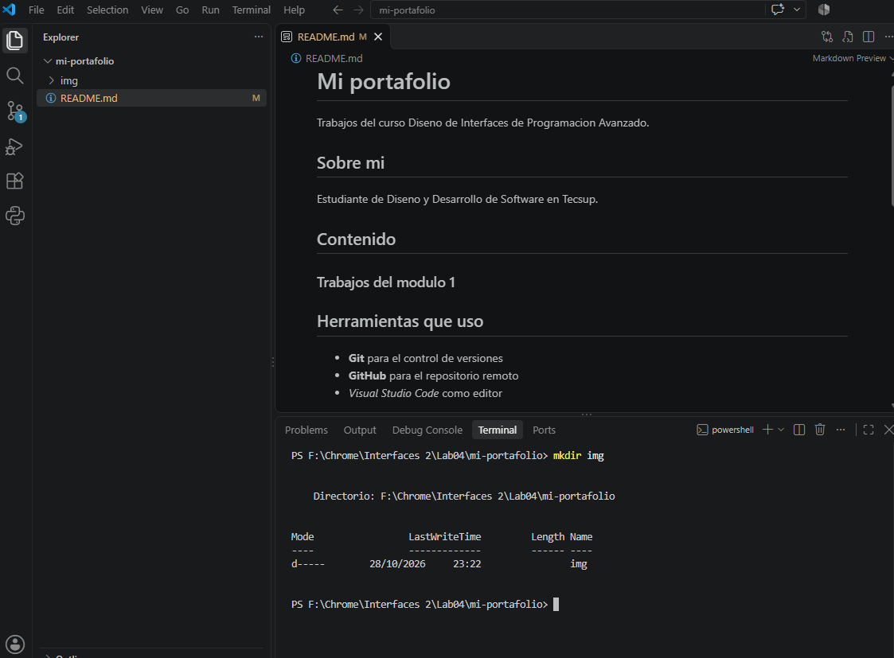

# Guía del proyecto: Tienda TECSUP

## 1. Descripción general

Tienda TECSUP es una página web sencilla que muestra productos, precios, cantidades y el total de una compra. Se desarrolló para practicar HTML, CSS y JavaScript durante el Laboratorio 03.

## 2. Archivos principales

| Archivo | Función |
|---|---|
| `index.html` | Muestra los productos y sus cantidades. |
| `estilos.css` | Define la apariencia de la página. |
| `script.js` | Calcula el total del carrito. |

## 3. Cómo revisar el proyecto

1. Abre el [repositorio Tienda TECSUP](https://github.com/chrismontes-lab/tienda-tecsup).
2. Descarga el proyecto con el botón Code o clónalo con Git.
3. Abre `index.html` en el navegador para visualizar la tienda.
4. Comprueba que el total considere el precio y la cantidad de cada producto.

### Comando para clonar el proyecto

```bash
git clone https://github.com/chrismontes-lab/tienda-tecsup.git
cd tienda-tecsup
```

Para comprobar los cambios realizados en el repositorio, puedes usar `git status`.

## 4. Lista de tareas

- [x] Identificar los archivos principales.
- [x] Corregir el cálculo del total del carrito.
- [x] Corregir la ruta del archivo CSS.
- [ ] Seguir mejorando la presentación de la tienda.

## 5. Captura de mi trabajo



## 6. Recurso de consulta

Puedes consultar la [guía oficial de Markdown](https://www.markdownguide.org/) para aprender a organizar documentación con encabezados, listas, tablas y enlaces.
